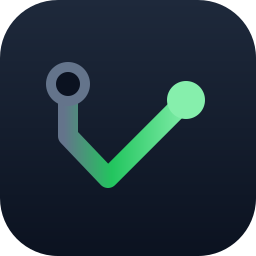

<p align="center"></p>

# mergeworthy

Work with an AI coding agent through GitHub, the way you work with a coworker. You give it an issue or a request, then review its PR and answer its questions on the thread. You don't prompt it step by step or babysit a chat.

- **It ships merge-ready PRs.** It opens a draft with the first push, then verifies bugs, reviews and simplifies the change before marking it ready (`converge`). A UI or runtime change is also checked in the real app.
- **It keeps its threads moving.** It watches its PRs and issues, and answers every review comment, bot finding and red CI run. When a PR it depends on lands, it updates its own.
- **It writes for busy reviewers.** A post leads with its verdict, ends with one decision and its pick, and links the long material. An independent review checks every post before it goes out.
- **It asks only what isn’t its to decide.** The agent decides, acts and reports, asking for permission or an unrankable fork with its recommendation (`always-on.md`).
- **Hooks hold the line.** Hooks block an unreviewed post, a PR marked ready without its review, and a third comment in a row within three hours.

## Install

```sh
npx mergeworthy
```

The installer finds the coding agents on this machine and asks which to install into and how to set the options. It installs through each agent's own plugin system:

| Agent | Gets | Updates |
|---|---|---|
| Claude Code | the skills, the hooks, the `bin/` commands and the always-on rules | automatically |
| Codex | the skills, and the always-on rules in `~/.codex/AGENTS.md` | re-run `npx mergeworthy` |
| Others, through [skills.sh](https://skills.sh) | the skills | `npx skills update` |

The hooks and the `bin/` commands read Markdown with Python's markdown-it-py: install it first (`sudo apt install python3-markdown-it`, or `pip install markdown-it-py`).

Run `npx mergeworthy` again to change the options or add an agent; `npx mergeworthy uninstall` removes mergeworthy.

## Options

| Option | Values (default first) | What changes |
|---|---|---|
| `badge` | `on`, `off`, `auto` | The icons of the agents that worked on a post, at its start; `auto`: only when posting from a human account. |
| `merge` | `on-request-squash`, `reviewer` | `reviewer`: the agent never merges. |
| `watcher` | `on`, `off` | `off`: no GitHub watcher. |

## What's inside

`always-on.md` is loaded in every session: the rules that always apply, and when to open each skill.

| Skill | What it covers |
|---|---|
| `task` | the first skill of any task: triage, scope, the project file, the watcher, then the deliverable's skill |
| `pull-request` | any change, from an issue or not, to a merge-ready PR |
| `reply` | the watcher's events and every comment the agent answers |
| `design` | a design question, an API, protocol or module, a proposal |
| `review` | reviewing a PR it didn't write |
| `open-issue` | one finding a newcomer can find, reproduce and judge |
| `docs` | docs, READMEs and JSDoc that read as the project's own |
| `delegate` | briefing subagents and checking their work; `skills/delegate/*.md` holds one brief template per role |
| `rules` | a named failure, a rule or mechanism that failed or can't be followed, editing the skills, the steward's follow-ups |
| `steward` | on request: one pass over what GitHub owes, this machine's sessions and the PR metrics, rule changes from the evidence, a report; nothing left running |
| `post`, `converge`, `merging`, `evidence`, `finality` | the procedures a step calls: posting through the review, the passes a PR runs until nothing worth changing is left, push to merge, screenshots and videos, rework of drifted code |
| `writing`, `code` | the standards every post and every diff is written to, and checked against (`~/.mergeworthy/voice.md` replaces the writing voice) |

`docs/mechanisms.md` describes the watcher, hooks and commands that enforce the steps.

## How the skills connect

`docs/graphs.md` has one graph per entry point of `always-on.md`, generated from the skills by `docs/build-graphs.py`. In each graph, each section is a box, its numbered steps run top to bottom, and a dashed arrow marks where a step hands over to another skill. After editing a skill, run `python3 docs/build-graphs.py`; CI fails while the graphs don't match the skills.

## Layout

```
always-on.md        the always-on rules and the index, in every session
skills/<name>/      one skill per task, procedure or standard; skills/delegate/ also holds the brief templates
hooks/              hooks.json and the scripts it runs
bin/                commands on the Bash PATH: gate-pass, post-lint, discussion-post, pr-steps, gh-watch-start, steward
watcher/            the GitHub watcher daemon gh-watch-start runs
cli/                the npx mergeworthy installer
docs/               graphs.md (generated from the skills), build-graphs.py, mechanisms.md
.claude-plugin/     the plugin manifest (options) and its marketplace
```

## Changing it

Edit here, commit and push; update each installed agent as listed in Install. To try a change before pushing, run `claude --plugin-dir .`.
